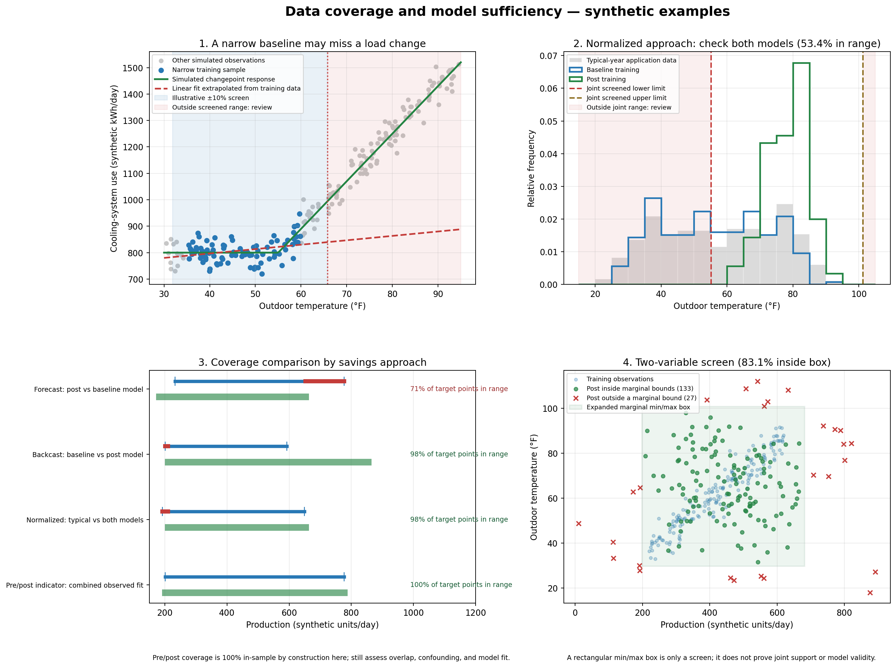

# Selecting Baseline and Post-Implementation Data Collection Periods

## Purpose

This guide helps project teams choose defensible baseline and post-implementation data periods for energy, water, demand, emissions, and production-performance measurement and verification (M&V). It is a planning aid; the project M&V plan, contract, applicable program rules, and selected M&V protocol control where they set specific requirements.

Savings are not directly metered. They are determined by comparing baseline use with post-implementation use on a consistent basis and making justified adjustments for changed conditions. Define the measurement boundary, savings question, and M&V method before selecting dates or installing meters.

## 1. Define what the periods must represent

For each measure or project, state:

- The equipment, process, facility, and commodities inside the measurement boundary.
- The outcome being evaluated: energy, demand, water, throughput-normalized intensity, emissions, cost, or another agreed metric.
- The operating conditions that drive the outcome, such as weather, production volume, product mix, operating hours, shifts, occupancy, feedstock quality, setpoints, and equipment availability.
- Whether the analysis is retrofit-isolated, whole-facility, or model-based, and which variables will be measured versus stipulated.
- The decision the result must support and the acceptable uncertainty or risk, balanced against the cost of collecting data.

The selected baseline and reporting periods should cover comparable operating modes, or the analysis should explicitly adjust for differences. Use the same calendar or operating-cycle boundaries where practical, while avoiding the assumption that identical dates alone make two periods comparable.

## 2. Select the baseline period

Choose a pre-implementation period that reflects normal, representative operation of the affected system and captures the variables needed by the selected M&V method.

- **Cover a complete annual cycle when seasonality matters.** A full year is a sound starting point for whole-facility utility analyses affected by weather or seasonal operation. Consider more than one year when year-to-year variability, unusual outages, or an atypical year could distort the baseline.
- **Cover the full process cycle when production is campaign-based.** For industrial measures, include representative product grades, batch or campaign phases, startup and shutdown behavior, shifts, and planned maintenance that materially affect energy or resource use. If the cycle is longer than a year, capture enough complete cycles to characterize normal performance.
- **Shorter periods can work for stable, isolated systems.** A shorter baseline may be appropriate when the relevant loads and operating factors are stable, the measurement boundary is narrow, and the selected method can characterize all material variation. Explain the evidence for representativeness and how unmeasured conditions are handled.
- **Avoid abnormal or transitional conditions unless they are part of normal operation.** Flag commissioning, breakdowns, curtailments, strikes, prolonged shutdowns, atypical weather, major process changes, and meter faults. Do not silently remove inconvenient data. Exclude, replace, or adjust data only under a documented rule that is applied consistently and preserves the intended baseline definition.
- **Do not wait until after installation to define the baseline.** Equipment changes can make pre-retrofit conditions impossible to recreate. Agree the baseline definition, instrumentation, dates, sampling, and records before implementation begins.

If reliable pre-implementation data do not exist, state the limitation and use a justified alternative, such as a calibrated simulation, engineering model, temporary metering, or documented comparable period. Identify assumptions and quantify their effect on uncertainty; do not label modeled or stipulated values as measured baseline data.

## 3. Select the post-implementation periods

Separate **post-installation verification** from the **savings reporting period**; they answer different questions.

1. **Post-installation verification window:** begins after the measure is installed and safe to operate. Use commissioning, inspections, spot measurements, and short-term or interval monitoring to confirm that the equipment and controls match the design and can perform as intended. Resolve startup and tuning issues before treating data as stable performance data. Record the dates and any commissioning adjustments.
2. **Reporting/performance period:** begins when the measure is accepted as operating under the defined post-installation conditions. Select a period long enough to include the relevant seasons, process cycles, and operating modes and to support the agreed savings calculation. For seasonal whole-facility savings, a full annual reporting period is generally the clearest comparison. For a stable isolated measure, a shorter or continuous period may be suitable if it captures all material variation and the M&V plan supports it.
3. **Persistence monitoring:** where performance may drift or controls, maintenance, or operator behavior affect savings, continue periodic or continuous measurement during later performance years. Annual verification is common in performance contracts, and more frequent checks can be useful for early fault detection. Set frequency based on risk, expected variability, and the agreement.

Do not treat the first post-installation readings as a full-year savings result. Identify the first stable operating date, distinguish commissioning data from reporting data, and explain any ramp-up, training, or production transition period.

## 4. Match data frequency and coverage to system behavior

Select the time interval and sampling plan based on how quickly the measured quantity and its drivers change.

- Use interval data fine enough to capture relevant starts, stops, peaks, cycles, and control response. A monthly utility bill cannot explain a short cycling event; high-frequency process behavior may require sub-hourly or event-based data.
- Align energy or water readings with production, operating hours, weather, and other independent variables at a common time basis. Record time zone, daylight-saving treatment, meter clock offsets, units, and aggregation rules.
- Prefer continuous monitoring for highly variable or interactive systems when the expected savings and risk justify it. For stable systems, periodic measurements may be adequate if they sample representative conditions and the method explicitly handles unsampled periods.
- For sampled equipment or production lines, define the population, strata or usage groups, sample selection, sample size, measurement frequency, and treatment of missing or failed samples before collecting data.
- Use the same instruments, locations, definitions, and interval conventions in baseline and reporting periods when possible. If they differ, document the difference and demonstrate comparability.

## 5. Check data quality before locking the periods

Before analysis, confirm that the chosen windows have adequate and traceable data:

- Meter and sensor identification, location, units, range, accuracy, calibration status, installation/removal dates, and data owner.
- Timestamp coverage, gaps, duplicate records, resets, communication failures, and outliers, with a documented treatment for each.
- Production and operating context, including throughput, product mix, hours, setpoints, outages, maintenance, and significant process or facility changes.
- Utility invoices or meter totals reconciled to interval data when both exist.
- Clear distinction between measured values, calculated values, estimates, and stipulated values, with source and rationale.
- A record of every data transformation, normalization, exclusion, imputation, and model version so the result can be reproduced.

Set acceptance rules in advance (for example, required coverage and maximum allowable gaps for each critical variable). If the data fail those rules, extend the collection window, repair the meter, use a justified substitute, or report the limitation and resulting uncertainty. Do not silently fill gaps or select a new period solely because it improves the savings result.

## 6. Handle changes between periods transparently

Compare the baseline and reporting conditions and classify changes before calculating savings:

- **Routine adjustments** address predictable drivers that vary within normal operation, such as weather, production volume, or operating hours. Use measured independent variables and an analysis method appropriate to the M&V option.
- **Non-routine adjustments** address material one-time changes in the facility or system, such as added production lines, changed product mix outside the modeled range, equipment replacement, a major schedule change, or a prolonged shutdown. Document the event, evidence, calculation method, direction and magnitude of its effect, and approval under the M&V plan.

Do not extrapolate a model beyond the range of conditions represented by its data without a justified method and explicit uncertainty statement. If the baseline becomes unrepresentative or the project boundary changes materially, pause and agree a revised analysis before reporting savings.

## 7. Practical period-selection checklist

Before data collection, the project team should be able to answer “yes” to each item:

- Is the baseline period defined before implementation and tied to a clear measurement boundary?
- Does it include the seasons, production cycles, and operating modes that materially affect the measure?
- Are unusual events and exclusions identified with an objective, documented treatment?
- Is the reporting period long enough to capture comparable conditions or support valid adjustments?
- Are commissioning verification and savings reporting treated as separate windows?
- Do sampling intervals and sample sizes match the variability, risk, and M&V option?
- Are all required meters, production records, timestamps, and data owners identified?
- Are data completeness rules, gap handling, adjustment methods, and reporting dates agreed in the M&V plan?
- Is the selected M&V effort proportionate to expected savings, uncertainty, project complexity, and the cost of measurement?

## 8. Document the decision in the M&V plan

For each measure or project, record a period schedule with:

| Item | Required entry |
|---|---|
| Baseline period | Start/end dates; rationale; seasons or cycles represented |
| Implementation boundary | Installation, commissioning, shutdown, and acceptance dates |
| Verification window | Start/end dates; checks; acceptance criteria; treatment of tuning |
| Reporting period | Start/end dates; first stable operating date; performance-year boundaries |
| Data plan | Variables, meters, interval/frequency, sampling, coverage rules, and responsible party |
| Adjustments | Routine variables, non-routine event process, model range, and approval path |
| Exceptions | Missing data, abnormal conditions, exclusions, substitutions, and effect on uncertainty |
| Review cadence | Interim checks, annual or other reporting dates, and decision owner |

Update the plan when field conditions materially differ from its assumptions, and retain both the original plan and approved revisions with the M&V record.

## Appendix A1.4: Data Coverage and Sufficiency

A long calendar duration does not by itself establish that a dataset is sufficient. The data must represent the operating conditions that drive energy or resource use, especially conditions where the measure is expected to save. Empirical models are most defensible when the training data span the application conditions. Applying a model outside that support can increase prediction error and make reported uncertainty too optimistic. BPA recommends quantifying both the amount and distance of out-of-sample application conditions, and considering whether those conditions are important to the measure (for example, hot-weather coverage for a cooling project). [BPA's Meter-Based Energy Modeling Protocol, Version 3.1, §3.1.3](https://www.bpa.gov/-/media/Aep/energy-efficiency/measurement-verification/7-bpa-mv-energy-modeling-protocol.pdf) discusses coverage, extrapolation, and the use of binning or expected energy to assess impact.

### A1.4.1 Coverage checks by savings approach

Identify the model-training dataset and the dataset to which each model is applied. When baseline and post-period models are fit separately, test each model against its own application dataset. Report the fraction of points outside the training support and, where possible, their expected energy or savings contribution. A simple count-based coverage factor is useful, but can understate risk when rare out-of-range conditions account for a large share of savings.

| Savings approach | Model training data | Application data | Coverage check |
|---|---|---|---|
| **Normalized savings** | Baseline and post models fitted separately, or a combined baseline/post model | Agreed typical conditions, such as TMY weather and typical production | For separate models, check the typical-condition inputs against both training datasets independently. For a combined model, check the typical inputs against the combined training support and confirm the baseline and post conditions are represented well enough to identify the period effect. |
| **Forecast / avoided use** | Baseline period | Post-period independent variables | Check whether post-period conditions fall within the baseline model's support. Quantify the amount, distance, and savings relevance of any extrapolation. |
| **Backcast / avoided use** | Post-implementation period | Baseline-period independent variables | Check whether baseline conditions fall within the post model's support. Quantify out-of-range conditions and their likely effect. |
| **Pre/post indicator model** | Combined baseline and post observations with a period indicator | Observed combined period for avoided-use estimates; agreed typical conditions for normalized estimates | For avoided use applied to the observed combined data, there is no separate future-period application comparison, but still assess variable overlap, period confounding, model fit, and support within each period. For normalized savings, compare typical conditions with combined training support. |

These labels describe common model-application patterns; project M&V plans and protocols may use different names or definitions. A pre/post model does not automatically solve poor coverage or confounding. If the baseline and post periods occupy different operating regimes, assess whether the period effect can be separated from those regime changes.

### A1.4.2 Range and extrapolation rules

BPA Version 3.1 describes the ASHRAE Guideline 14 allowance for up to 10% extrapolation above or below the baseline ambient-temperature range for models using ambient temperature. Treat this as a variable- and protocol-specific allowance, not a universal rule requiring every independent variable to use the formula below or requiring all outside points to be discarded.

For positive-scale variables when the governing protocol supports a proportional screen, a project may define an illustrative application window as:

`[0.90 × X_min, 1.10 × X_max]`

Document the selected rule, units, training range, and rationale. Do not apply proportional multiplication blindly to temperatures in °C or °F, variables that can be negative, or variables whose zero point is arbitrary; use the protocol's actual tolerance or a physically meaningful transformed scale. For nonlinear or change-point behavior, a min/max check alone may miss unsupported combinations or an unobserved operating regime.

Out-of-range observations are a **review trigger**, not an automatic exclusion rule. Follow the governing M&V protocol and project plan. Quantify how much of the application period is out of range, how far it extends, and whether the excluded or extrapolated observations materially affect energy or savings. If coverage is insufficient for the savings question, consider extending data collection, revising the model or boundary, choosing a different savings approach, or using a calibrated simulation where appropriate. Document any exclusions and sensitivity analysis; do not choose a method simply because it produces a more favorable result.

### A1.4.3 Data sufficiency assessment log (Table A1.4.1)

Complete a log during baseline planning and update it after implementation. The example entries below are hypothetical and illustrate documentation; they are not acceptance thresholds.

| Parameter | Duration / dataset | Representativeness and coverage | Sufficiency / action | Notes |
|---|---|---|---|---|
| Production volume | Illustrative post period: April–September (6 months) | Covers 85% of the typical production range; winter operating modes are not represented | Review savings relevance of the missing 15%; extend the period or report a sensitivity if unsupported conditions matter | A percentage of the range is not the same as a percentage of energy or savings. |
| Measurement frequency and gaps | Hourly; 0.5% missing in this hypothetical example | Two outages totaling four hours | Apply only the pre-approved gap treatment; document and test sensitivity to the treatment | Keep raw data and the gap-treatment record. |
| Variables and alignment | Energy, production, operating hours, and outdoor temperature | All listed channels present in the example period | Confirm common timestamps, units, measurement boundary, and coverage of each model input | Identify source, meter, calibration, and responsible data owner. |

A useful log records, for each independent variable, its baseline and post training ranges, target/application range, proportion and energy-weighted share outside the support, known change points, data gaps, selected rule, and resulting action. For multivariable models, also inspect joint support: observations can fall within each variable's separate min/max range while representing a combination never observed in training.

### A1.4.4 Four-panel coverage demonstration

The figure and script below use synthetic data to illustrate a changepoint model, normalized weather coverage, model/application ranges under four savings approaches, and a two-variable marginal-range screen. They are diagnostic examples only; their simulated thresholds and coverage values are not universal sufficiency criteria. The two-variable plot uses a rectangular min/max screen, which does not establish joint support.

[Open the interactive data coverage and sufficiency demonstration](data-coverage-sufficiency-demo.html) in a browser, or use the static preview below. The interactive view lets readers adjust synthetic baseline/post ranges, data window length, review margin, and analysis approach.



Run the reproducible [Python demonstration](data_coverage_sufficiency_demo.py) with NumPy and Matplotlib:

```bash
python3 guides/data_coverage_sufficiency_demo.py --output guides/data_coverage_sufficiency_demo.png
```

The script reports example coverage values and saves the figure. It does not decide whether a real project is sufficient or automatically exclude data.

## References

- U.S. Department of Energy, Federal Energy Management Program (FEMP), [M&V Guidelines: Measurement and Verification for Federal Energy Projects, Version 5.0](https://www.energy.gov/sites/default/files/2024-10/mv_guide_5_0.pdf), especially its M&V plan and post-installation/performance-period reporting guidance.
- U.S. Department of Energy, FEMP, [Measurement and Verification Activities Required in the Energy Savings Performance Contract Process](https://www.energy.gov/cmei/femp/measurement-and-verification-activities-required-energy-savings-performance-contract).
- U.S. Department of Energy, FEMP, [Measurement and Verification Options for Federal Energy- and Water-Saving Projects](https://www.energy.gov/cmei/femp/measurement-and-verification-options-federal-energy-and-water-saving-projects).
- Bonneville Power Administration, [Verification by Meter-Based Energy Modeling Protocol, Version 3.1](https://www.bpa.gov/-/media/Aep/energy-efficiency/measurement-verification/7-bpa-mv-energy-modeling-protocol.pdf), especially §3.1.3 on selecting time intervals and assessing coverage.
- Efficiency Valuation Organization, [International Performance Measurement and Verification Protocol (IPMVP)](https://evo-world.org/en/products-services-mainmenu-en/protocols/ipmvp).
